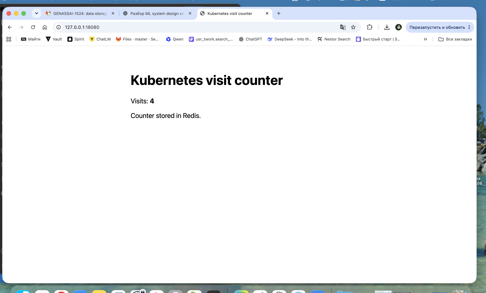

# Лабораторная работа 4 — More Kubernetes

## Что сделано

Самостоятельное приложение «счётчик посещений»: веб-сервис на Python показывает число открытий страницы, а Redis хранит счётчик. При обращении к `/` Python отправляет Redis команду `INCR visits`. Оба сервиса работают в отдельных `Deployment` и соединяются через внутренний `Service` Redis.

Работа находится целиком в `lab4/` и не зависит от файлов лабораторных 1–3. Ресурсы создаются в отдельном namespace `lab4`, чтобы не пересекаться с другими учебными заданиями.

## Архитектура

```text
браузер → Service/counter → Deployment/counter → Service/redis → Deployment/redis
                              ├─ initContainer wait-for-redis
                              ├─ ConfigMap counter-config
                              └─ emptyDir /work (маркер завершения init)

Deployment/redis → emptyDir /data (данные Redis)
```

При старте init-контейнер проверяет Redis командой `PING` и записывает `/work/redis-ready` в общий `emptyDir`. Только после его успешного завершения Kubernetes запускает веб-контейнер. Readiness веб-контейнера проверяет и файл, и связь с Redis; liveness проверяет работу HTTP-сервера. У Redis тоже есть readiness и liveness проверки через `redis-cli ping`.

`emptyDir` хранит данные только пока существует Pod. Если Pod Redis будет создан заново, счётчик начнётся с нуля. Для учебной работы это демонстрирует volume; для долговременного хранения вместо него нужен PersistentVolumeClaim.

## Соответствие требованиям

| Требование | Реализация |
| --- | --- |
| Минимум два Deployment | `counter`, `redis` |
| Собственный образ | `lab4-counter:1.0.0` из `app/Dockerfile` |
| Контейнер и init-контейнер | `counter` и `wait-for-redis` в `Deployment/counter` |
| Volume | `emptyDir` `/work` в `counter` и `/data` в `redis` |
| ConfigMap или Secret | `counter-config` передаёт адрес Redis и настройки приложения |
| Service | `counter` (HTTP) и `redis` (внутренний TCP) |
| Пробы | HTTP liveness/readiness у `counter`, `redis-cli ping` у Redis |
| Дополнительные labels | `app.kubernetes.io/component`, `app.kubernetes.io/part-of` и другие |

## Состав файлов

- `app/Dockerfile` — собственный образ веб-сервиса без сторонних Python-пакетов.
- `app/server.py` — HTTP-сервер и клиент протокола Redis.
- `app/wait_for_redis.py` — команда init-контейнера.
- `k8s/` — namespace, ConfigMap, два Deployment, два Service и `kustomization.yaml`.
- `tests/test_integration.py` — локальный интеграционный тест с настоящим Redis.

## Проверенный запуск на этом ноутбуке: Colima

22 ноября 2026 года работа была развёрнута в **локальном** кластере Colima. Собственный образ собран в Docker Desktop, затем вместе с Redis перенесён в Colima через локальный архив: это обошлось без изменения доверенных сертификатов VM. Все команды Kubernetes обращались к явному контексту `colima`.

Из корня репозитория воспроизвести запуск можно так:

```bash
env -u DOCKER_HOST docker --context desktop-linux build -t lab4-counter:1.0.0 lab4/app
env -u DOCKER_HOST docker --context desktop-linux pull redis:7.4-alpine
env -u DOCKER_HOST docker --context desktop-linux save -o /tmp/lab4-images.tar lab4-counter:1.0.0 redis:7.4-alpine
colima start --kubernetes --cpu 2 --memory 4
env -u DOCKER_HOST docker --context colima load -i /tmp/lab4-images.tar
kubectl --context colima apply -k lab4/k8s
kubectl --context colima -n lab4 rollout status deployment/redis --timeout=120s
kubectl --context colima -n lab4 rollout status deployment/counter --timeout=120s
```

Результат проверки: `counter` и `redis` — оба `1/1 Available`; оба Pod — `Running`, без перезапусков; init-контейнер `wait-for-redis` завершился с кодом `0`; оба HTTP health endpoint вернули `200`; два обращения к приложению через `Service/counter` показали `Visits: 1` и `Visits: 2`.

## Альтернатива: запуск в Minikube

Нужен **локальный** кластер Kubernetes с `kubectl` и доступом к публичным образам. Пример ниже использует Minikube; выполнение ЛР 3 для этого не требуется. Перед развёртыванием проверьте, что Minikube запущен и `kubectl --context=minikube get nodes` показывает локальную ноду. Во всех командах ниже контекст указан явно.

Из корня репозитория:

```bash
minikube start
minikube image build -t lab4-counter:1.0.0 lab4/app
kubectl --context=minikube apply -k lab4/k8s
kubectl --context=minikube -n lab4 rollout status deployment/redis --timeout=120s
kubectl --context=minikube -n lab4 rollout status deployment/counter --timeout=120s
kubectl --context=minikube -n lab4 get deployments,pods,services -o wide
```

Образ `lab4-counter:1.0.0` собирается из собственного Dockerfile прямо в Minikube. Манифест указывает `imagePullPolicy: IfNotPresent`, поэтому Pod использует локально собранный образ. Redis берётся из публичного `redis:7.4-alpine`.

Проверка init-контейнера, labels и проб:

```bash
kubectl --context=minikube -n lab4 logs deployment/counter -c wait-for-redis
kubectl --context=minikube -n lab4 get pods --show-labels
kubectl --context=minikube -n lab4 describe deployment counter
kubectl --context=minikube -n lab4 exec deployment/counter -c counter -- cat /work/redis-ready
```

Открытие приложения (команда занимает терминал до `Ctrl+C`):

```bash
kubectl --context=minikube -n lab4 port-forward service/counter 8080:80
```

Затем открыть `http://127.0.0.1:8080/` и обновить страницу несколько раз: число `Visits` должно увеличиваться. `http://127.0.0.1:8080/health/live` и `/health/ready` должны отвечать `200`.

## Локальная проверка без кластера

Для интеграционного теста нужен установленный `redis-server`; Docker и Kubernetes ему не нужны:

```bash
PYTHONDONTWRITEBYTECODE=1 python3 -m unittest discover -s lab4/tests -v
kubectl kustomize lab4/k8s
```

Тест запускает Redis и HTTP-сервер только на `127.0.0.1`, проверяет readiness до и после выполнения init-скрипта и два последовательных увеличения счётчика, затем останавливает оба процесса. `kubectl kustomize` только собирает манифесты в стандартный вывод и не подключается к кластеру.

## Скриншоты для отчёта

На момент подготовки инструкции Colima остановлена. Перед снимками запустите её и проверьте локальные Pod:

```bash
colima start --kubernetes --cpu 2 --memory 4
kubectl --context colima -n lab4 rollout status deployment/redis --timeout=120s
kubectl --context colima -n lab4 rollout status deployment/counter --timeout=120s
```

Если ресурсы отсутствуют, повторите `kubectl --context colima apply -k lab4/k8s` из корня репозитория; образы уже загружены в локальный Docker Colima.

Сохраните в `lab4/screenshots/` следующие снимки **локального** кластера:

1. `01-resources.png` — вывод `kubectl --context colima -n lab4 get deployments,pods,services -o wide`: оба Deployment `1/1`, оба Pod `Running`.
2. `02-init-and-probes.png` — вывод `kubectl --context colima -n lab4 describe pod -l app.kubernetes.io/name=counter`: статус init-контейнера `Completed`, поля `Liveness` и `Readiness`.
3. `03-app.png` — страница `http://127.0.0.1:18080/` с увеличивающимся счётчиком. Для открытия страницы запустите `kubectl --context colima -n lab4 port-forward --address 127.0.0.1 service/counter 18080:80`, после снимка нажмите `Ctrl+C`.

Снимок страницы из локального запуска уже сохранён; его можно заменить своим:



Первые два снимка команда добавит после проверки в своём терминале.
